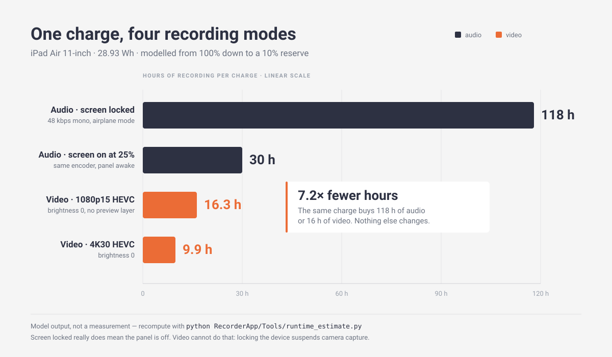
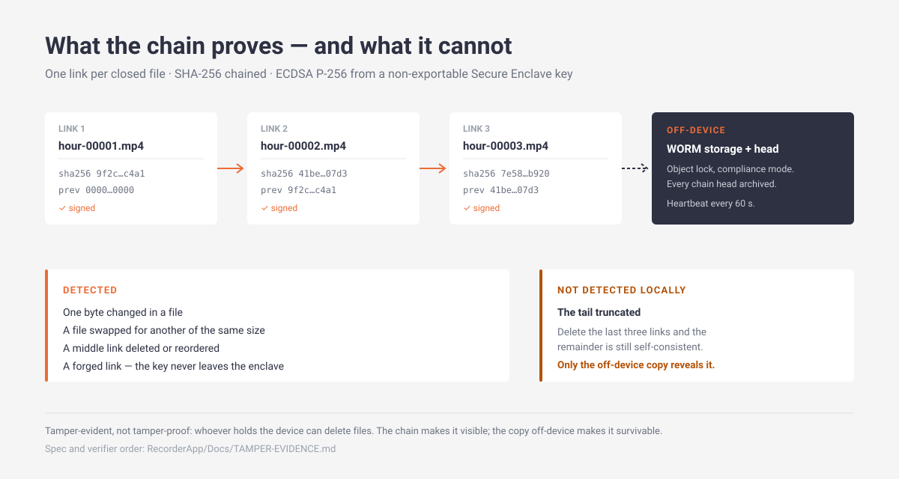

# Continuous Recorder


A native SwiftUI app for an always-on iPad: continuous audio that survives screen lock, an
hourly-segmented video recorder, and a signed hash chain that makes local editing or
deletion detectable.

Written on Windows, where there is no Swift toolchain — so the code in this repository has
**never been compiled**. CI is the first real build gate. Read
[`RecorderApp/Docs/MAC-HANDOFF.md`](RecorderApp/Docs/MAC-HANDOFF.md) before pressing ⌘R.



## Three answers up front

**1. Turning the display off.** Brightness can be driven to 0% (`UIScreen.brightness`), and
that saves ~0.2 W. Actually powering the panel off requires locking the device — and locking
**suspends camera capture**. iOS has no camera background mode, so "video with the screen
off" does not exist on this platform. Audio does survive lock, which is why audio runs for
days and video runs for hours:

| Mode | Panel | 11" iPad Air | 13" |
|---|---|---|---|
| Audio, screen locked | genuinely off | **118 h** (4.9 d) | 150 h (6.2 d) |
| Video 1080p15 HEVC, brightness 0 | lit at minimum | **16.3 h** | 20.6 h |
| Video 1080p30 HEVC, brightness 0 | lit at minimum | 14.7 h | 18.6 h |
| Video 4K30 HEVC, brightness 0 | lit at minimum | 9.9 h | 12.6 h |

Full reasoning and the thermal/storage consequences:
[`Docs/POWER-AND-DISPLAY.md`](RecorderApp/Docs/POWER-AND-DISPLAY.md). If 24/7 video with no
panel is a hard requirement, an iPad is the wrong capture device — a PoE camera is, and the
iPad becomes the ingester/verifier.

**2. One file per hour.** An `AVAssetWriter` only produces a playable file at
`finishWriting`, so an hour-long file is an hour of exposure on power loss. The recorder
supports both: `segmentDuration` defaults to 3600 s as asked, with 600 s documented as the
safer setting plus an `ffmpeg -c copy` rollup for hourly deliverables. Storage is the hard
limit: 1080p15 HEVC is **1.8 GB/h, 43 GB/day** — 100 GB holds 2.3 days, so upload is
mandatory, not optional.

**3. On-prem tampering.**



You cannot make a file undeletable on a device someone holds. You can make modification
detectable: a SHA-256 hash chain signed by a **non-exportable Secure Enclave key**, one link
per closed file, with the chain head shipped off-device. Deleting a middle file breaks the
chain; editing one byte breaks the file hash; **truncating the tail is invisible locally** —
that is asserted in a test, and the fix is an off-device anchor plus a 60-second heartbeat,
not more cryptography. Full threat model:
[`Docs/TAMPER-EVIDENCE.md`](RecorderApp/Docs/TAMPER-EVIDENCE.md).

## Kiosk mode

Four requirements, three of which are deployment configuration rather than code:

| Requirement | Possible? | What actually does it |
|---|---|---|
| Only this app runs | Partly | `UIAccessibility.requestGuidedAccessSession` when Guided Access is enabled; MDM single-app mode on a supervised device |
| Zero brightness | Yes | `UIScreen.brightness = 0` — but at 0 the watermark is invisible, so the default floor is 0.04, worth about 12 minutes of runtime |
| All radios off | **No** | Airplane Mode, set by a human or MDM. The app can only observe `NWPathMonitor` and record when a path appears mid-session |
| Timestamp + battery + charging stamp | Yes | `TelemetryWatermark` on screen (drifting, so it cannot burn in); `WatermarkComposer` burns it into the file |

The ordering constraint is the interesting one: `finishWriting → burn → SHA-256 → chain link`.
Hash first and you sign bytes that no longer exist on disk, so every file verifies as
tampered. Burning costs a full re-encode per segment (+40–100% energy per recorded hour), so
it is a mains-only option; the chain payload carries the same numbers for free.

[`Docs/KIOSK-MODE.md`](RecorderApp/Docs/KIOSK-MODE.md) covers the Guided Access and MDM
tiers, what `NWPathMonitor` does and does not prove, and the clock-drift consequence of
Airplane Mode on a watermark that is supposed to be evidence.

## Motion: did someone touch it?

`MotionMonitor` samples device motion at 10 Hz; `MotionClassifier` runs a two-threshold
hysteresis over acceleration, angular velocity and the gravity vector. When it enters
"moving" it arms `SnapshotGate`, and the video pipeline hands over **one frame per second**
for as long as the episode lasts. Each frame is JPEG'd at 1280 px, hashed, and listed in an
`event.json` that is signed into the chain as a single link.

The interesting signal is not "it moved" — a lorry outside will do that all day — it is
`reaimed`: a gravity change above 5° means the device is now pointing somewhere else. A
knock keeps `reaimed: false`. Two thresholds, not one, because a single threshold chatters on
every vibration and a system that chatters is a system whose alerts get ignored.

Two caveats worth knowing before relying on it, both in
[`Docs/MOTION.md`](RecorderApp/Docs/MOTION.md): gravity cannot see yaw, so a flat device spun
in place is recorded as an event but not as a re-aim; and in full video mode the stills are
redundancy — for retrieval, for alerting, and for the hour a power cut leaves unplayable —
not the proof itself. Each snapshot carries its video presentation time, so a reviewer can
seek the exact frame instead of guessing from wall clock.

## Sharing with a Mac, behind Face ID

`UIFileSharingEnabled` is read at launch and cannot be gated at runtime, so the gate is on the
contents. Recordings live in `Library/Recordings`, which File Sharing never exposes. Opening a
window — after `LAContext.evaluatePolicy(.deviceOwnerAuthentication)`, i.e. Face ID or Touch ID
with the passcode as fallback — creates **hard links** under `Documents/Share/<stamp>/`.

Hard links are what make this cheap and safe: instant even for 40 GB, no extra disk, and
unlinking them cannot touch the original. The window closes on expiry (10 minutes), on
backgrounding, and when the device locks; locking mid-copy aborts the transfer, which is the
intended trade and why the countdown is on screen. Every open and close lands in
`share-access.jsonl`.

If no passcode is set, `canEvaluatePolicy` returns false and sharing is **refused with an
explanation** rather than falling open — the failure mode of an access control has to be
closed. Details, including what this does not protect against:
[`Docs/SHARING.md`](RecorderApp/Docs/SHARING.md).

## Why the code looks the way it does

| Decision | Reason |
|---|---|
| `AVAudioEngine` tap, not `AVAudioRecorder` | `AVAudioRecorder` rebuilds the capture path between files, leaving a 20–80 ms hole at every boundary. With one continuous tap, only the destination file changes. |
| Segmented media (5 min audio, 1 h video) | A compressed container is only playable after it is closed. Segment length is the blast radius of a crash, not a formatting taste. |
| `.record` category + `audio` background mode | Input-only: no output route activates, so it is cheaper than `.playAndRecord`. Keeps audio alive while locked. |
| No preview layer in the video path | The compositor is the second-largest display cost after the backlight, and nobody is watching a dimmed screen. |
| Brightness saved and restored | `UIScreen.brightness` is global; leaving a shared device at 0% is a support ticket. |
| Power policy at segment boundaries | Polling battery, disk and thermal state once per second costs more than it saves. |
| Engine stopped/started outside the lock | `engine.stop()` waits on the render thread, and the render thread takes the same lock — a hang that only appears on device under load. |
| Integers, not floats, in the signed payload | `3600` and `3600.0` are different bytes; a verifier in Python must be able to reproduce the canonical form exactly. |
| Software signer must self-identify | Simulator chains are signed by a key in process memory; every link carries `signerID` so a verifier can refuse them. |

## Repository layout

```
.
├─ README.md                 this file
├─ LICENSE                   Apache-2.0
├─ NOTICE                    attribution notice
├─ CHANGELOG.md              keep-a-changelog, release notes are cut from it
├─ VERSION                   0.1.0 — single source of truth for the tag
├─ assets/                   infographics (hand-authored SVG + PNG export)
├─ scripts/
│  ├─ local_ci.py            every check that does not need a Swift toolchain
│  └─ release.py             local CI → tag → push → gh release
├─ .github/workflows/ci.yml  static checks + macOS build/test
└─ RecorderApp/
   ├─ project.yml                 XcodeGen spec (Path A)
   ├─ Sources/
   │  ├─ App/RecorderApp.swift    @main + app delegate
   │  ├─ Core/
   │  │  ├─ SegmentedRecorder.swift    audio: engine, tap, rotation, interruptions
   │  │  ├─ HourlyVideoRecorder.swift  video: AVCaptureSession + AVAssetWriter
   │  │  ├─ DisplayGovernor.swift      brightness 0, idle timer, restore
   │  │  ├─ TamperChain.swift          hash chain, canonical encoding, verifier
   │  │  ├─ LinkSigner.swift           Secure Enclave ECDSA + software fallback
   │  │  ├─ SegmentWriter.swift        one audio file + finalisation
   │  │  ├─ AudioSessionController.swift  category, activation, notifications
   │  │  ├─ RecordingProfile.swift     codec/bitrate presets and storage maths
   │  │  ├─ RecordingRecords.swift     SegmentRecord, GapRecord, CoverageSummary
   │  │  ├─ ManifestStore.swift        session.json + segments.jsonl / gaps.jsonl
   │  │  ├─ FileStore.swift            Documents/Recordings/yyyy-MM-dd/HHmmss-id/
   │  │  ├─ PowerGovernor.swift        stop/downgrade policy
   │  │  ├─ EnergyModel.swift          capacity, hours, observed-watts meter
   │  │  └─ Locked.swift               lock wrapper for audio-thread values
   │  ├─ Kiosk/
   │  │  ├─ KioskController.swift      Guided Access, brightness floor, idle timer
   │  │  ├─ KioskStatus.swift         what a healthy kiosk looks like, as data
   │  │  ├─ RadioMonitor.swift        NWPathMonitor; cannot disable radios, only observe
   │  │  ├─ TelemetryFormat.swift     deterministic stamp text + drift
   │  │  ├─ TelemetryWatermark.swift  the on-screen stamp and issue list
   │  │  └─ WatermarkComposer.swift   optional burn-in before hashing
   │  ├─ Motion/
   │  │  ├─ MotionMonitor.swift        CoreMotion at 10 Hz
   │  │  ├─ MotionClassifier.swift     hysteresis, bump versus re-aim
   │  │  ├─ MotionSnapshots.swift      snapshot gate + JPEG encoder
   │  │  └─ MotionEventRecorder.swift   event JSON, per-frame hashes, one chain link
   │  ├─ Sharing/
   │  │  ├─ SharePlan.swift            which files, and what truncation costs
   │  │  ├─ DeviceAuthenticator.swift  LAContext seam; Face ID + passcode fallback
   │  │  └─ EvidenceShareController.swift  hard-link window, timers, access log
   │  ├─ UI/                           RecorderViewModel + ContentView
   │  └─ Resources/Info.plist          mic + camera usage, background audio
   ├─ Tests/                          54 unit tests
   ├─ Tools/
   │  ├─ runtime_estimate.py          power/storage model, audio and video modes
   │  └─ sanity_check.py              structural lint + plist validation
   └─ Docs/
      ├─ RUNTIME-ESTIMATE.md
      ├─ POWER-AND-DISPLAY.md
      ├─ TAMPER-EVIDENCE.md
      ├─ KIOSK-MODE.md
      ├─ MOTION.md
      ├─ SHARING.md
      └─ MAC-HANDOFF.md
```

## Status of the video and tamper modules

They are written to the same standard as the audio path and are **not wired into the UI
yet**. Both are self-contained; integration is about twenty lines:

```swift
// video
guard await HourlyVideoRecorder.requestCameraAccess() else { return }
let video = HourlyVideoRecorder()
video.onSegmentClosed = { record in
    // hash after finishWriting, never before
    try? chain.append(fileAt: url, relativePath: record.relativePath,
                      durationSeconds: record.durationSeconds)
}
try video.start(settings: .init())
displayGovernor.enterSurveillanceMode()

// on stop
video.stop()
displayGovernor.exitSurveillanceMode()
```

Where `chain = TamperChain(directory: videoDirectory, signer: SecureEnclaveSigner())`. The
ordering matters: the chain hash must cover the finished container, so it goes in
`onSegmentClosed`, not next to `start()`.

## Building

```bash
brew install xcodegen
cd RecorderApp && xcodegen generate && open RecorderApp.xcodeproj
```

Set your signing team, pick the iPad, ⌘R. No XcodeGen? Path B in the hand-off doc takes
three minutes with a fresh Xcode project.

## Local CI and releasing

`scripts/local_ci.py` runs everything that does not need macOS — Swift structural lint,
plist and YAML validation, power-model invariants, markdown link integrity, SVG validity,
version consistency, credential scan. It is the `checks` job in CI, and it is the gate
before a release:

```bash
python scripts/local_ci.py          # exit 0 = green
python scripts/release.py --dry-run # show the tag/push/release commands
python scripts/release.py           # CI → tag → push → gh release, notes from CHANGELOG
```

`release.py` refuses to run on a dirty tree, on a branch other than `main`, on a version
that has no CHANGELOG section, or when local CI fails.

The macOS `build` job is the part that actually compiles and runs the 54 unit tests. It has
never executed — expect to fix a handful of things on its first run, and treat its first
green as the real 1.0.

## What is verified, and what is not

Verified here, repeatedly:

```bash
python scripts/local_ci.py                                 # 9 checks, all green
python RecorderApp/Tools/sanity_check.py                   # 37 Swift files, 0 issues
python RecorderApp/Tools/runtime_estimate.py --mode video   # the numbers above
```

Both local CI failure paths were exercised on purpose — an unclosed brace in a Swift file
and a dead markdown link each turn it red.

Not verified, because there is no Swift toolchain or iOS SDK on this machine:
**compilation, the 54 unit tests, and every line of audio, camera and Keychain behaviour.**
The Secure Enclave path cannot be exercised anywhere but a real device with a passcode —
the simulator has no SE, which is why `SoftwareSigner` exists and why links record which one
signed them.

## License

Apache License 2.0 — see [LICENSE](LICENSE). Attribution in [NOTICE](NOTICE).
